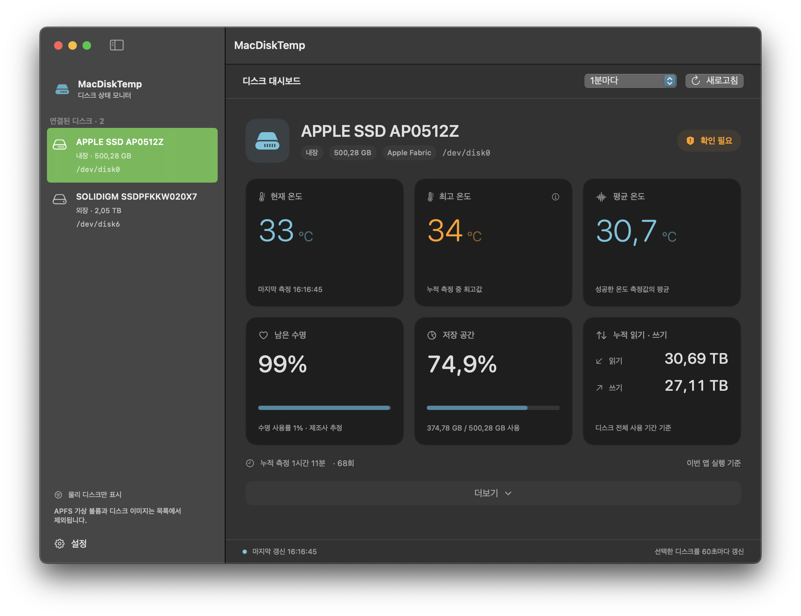
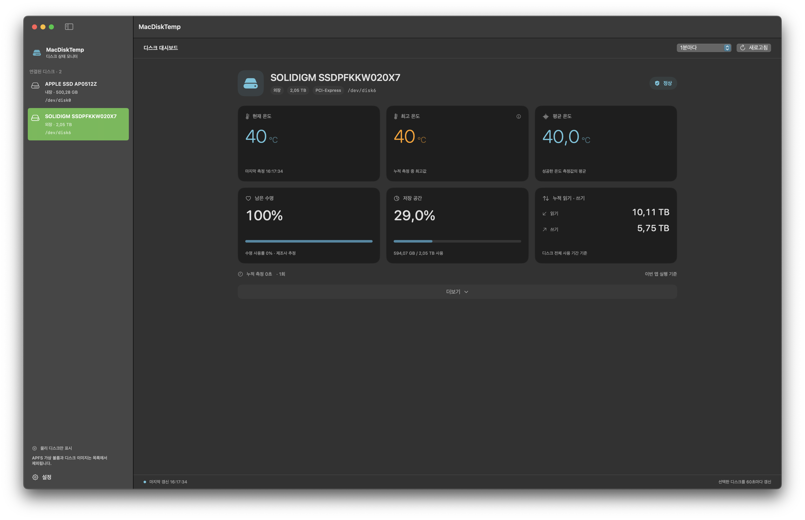
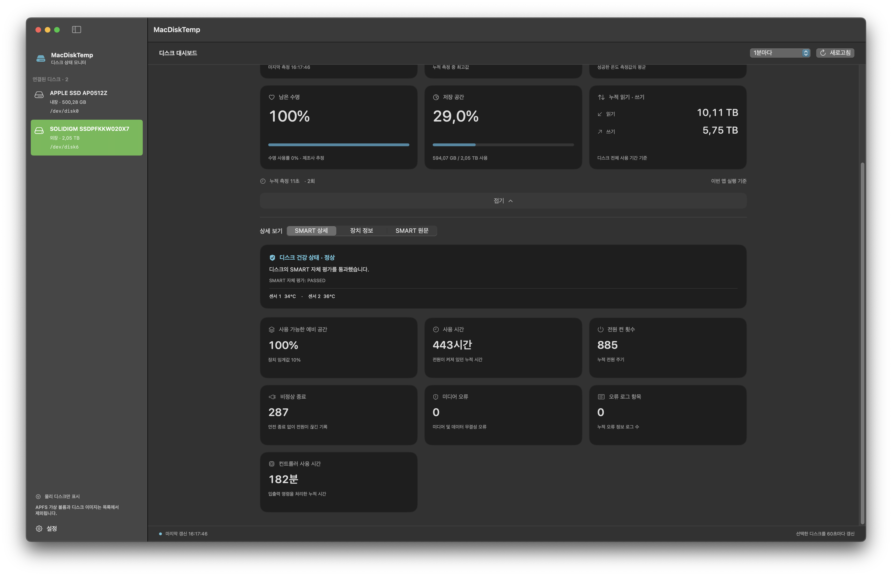
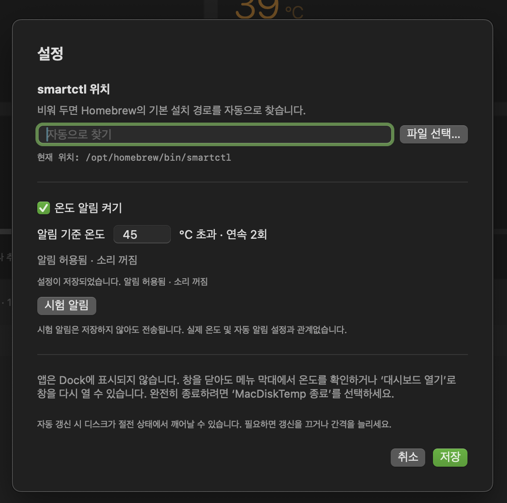

# MacDiskTemp

**Mac의 디스크 온도와 SMART 상태를 메뉴 막대와 대시보드에서 확인하세요.**

내장·외장 물리 디스크를 선택해 온도, 남은 수명, 저장 공간, 누적 읽기·쓰기를 살펴보는 macOS 앱입니다. 창을 닫아도 메뉴 막대에서 선택한 디스크의 온도를 확인할 수 있습니다.

macOS 13 이상 · SwiftUI · MIT License

[시작하기](#시작하기) · [사용 방법](#사용-방법) · [온도 알림](#온도-알림-040) · [기술 안내](docs/TECHNICAL.md) · [개인정보](PRIVACY.md)

<p align="center">
  
</p>

내장 디스크의 주요 상태를 한 화면에서 확인할 수 있습니다.

<details>
<summary>외장 디스크와 SMART 상세 화면 보기</summary>

**외장 디스크 대시보드**



**SMART 상세 정보**



</details>

## 주요 기능

| 기능 | 할 수 있는 일 |
| --- | --- |
| 온도 모니터링 | 현재·최고·평균 온도 확인, 메뉴 막대 표시 |
| 온도 알림 | 기준 초과 2회 알림, 중복 방지, 시험 알림과 재실행 복원 |
| 디스크 대시보드 | 남은 수명·저장 공간 사용률·누적 읽기 및 쓰기 확인 |
| SMART 상세 보기 | 장치 정보, 건강 상태, 텍스트·JSON 원문 확인 및 복사 |
| 자동 갱신 | 15초·30초·1분·5분 간격 선택, 수동 새로고침 |
| 설치 안내 | 필요한 Homebrew·smartmontools 설치를 앱에서 시작 |

표시되는 정보는 디스크와 연결 장치가 제공하는 항목에 따라 달라집니다. 최고·평균 온도는 이번 앱 실행 중 측정한 값이며, 앱을 완전히 종료하면 초기화됩니다.

## 시작하기

### DMG 또는 앱 ZIP을 받은 경우

**완성된 배포 파일은 직접 빌드하지 않고 사용할 수 있습니다.**

1. DMG를 열고 `MacDiskTemp.app`을 `Applications`로 끌어다 놓습니다. 앱 ZIP은 압축을 푼 뒤 앱을 응용 프로그램 폴더로 옮깁니다.
2. 응용 프로그램 폴더에서 **MacDiskTemp**를 실행합니다.
3. 설치 화면이 나오면 **자동 설치 시작**을 누르고 터미널의 안내를 따릅니다.

파일명의 CPU 종류를 확인하세요. `arm64`는 Apple Silicon, `x86_64`는 Intel용입니다. 현재 준비된 DMG는 Apple Silicon용이며, 소스 코드 ZIP에는 완성된 앱이 포함되지 않습니다.

> 현재 배포본은 임시 서명(ad-hoc) 상태이며 Apple Developer ID 서명·공증은 적용되지 않았습니다. 다운로드한 앱 실행이 차단되면 출처를 확인하고 [Apple의 실행 안내](https://support.apple.com/en-us/102445)를 참고하세요.

### 소스를 받은 경우

Xcode 16 이상 또는 Swift 6 이상이 필요합니다. 다운로드하거나 복제한 프로젝트 폴더를 터미널에서 열고 실행합니다.

```sh
bash Scripts/build-app.sh
open dist/MacDiskTemp.app
```

빌드한 Mac의 CPU에 맞는 앱·DMG·ZIP과 `SHA256SUMS.txt`가 `dist/`에 생성됩니다. 외부 Swift 패키지 의존성은 없습니다.

### 실행 환경

- **macOS 13 이상**과 **smartmontools 7 이상**이 필요합니다.
- `smartctl`이 없으면 앱에서 설치를 시작할 수 있습니다. 설치에는 인터넷이 필요하지만 디스크 조회 자체에는 필요하지 않습니다.
- 앱의 최소 macOS 버전과 Homebrew의 지원 범위는 다릅니다. Intel이나 이전 macOS에서는 설치 지원이 제한될 수 있으니 [Homebrew 요구 사항](https://docs.brew.sh/Installation)을 확인하세요.

## 사용 방법

1. 왼쪽 목록에서 확인할 **물리 디스크**를 선택합니다.
2. 여섯 개 카드에서 온도와 디스크 상태를 살펴봅니다. **더보기**를 누르면 SMART 상세 항목을 확인할 수 있습니다.
3. 자동 갱신 간격을 선택하거나 `⌘R`로 새로고침합니다. 기본 간격은 30초입니다.
4. 창을 닫은 뒤에는 메뉴 막대에서 온도를 확인하고 대시보드를 다시 열 수 있습니다. 종료할 때는 **MacDiskTemp 종료**를 선택합니다.

앱은 Dock과 `⌘Tab` 목록에 표시되지 않습니다. **최고 온도** 카드에 마우스를 올리면 장치가 제공한 온도 기준과 경고 유지 시간을 볼 수 있습니다.

## 온도 알림 (0.4.0)

**설정 → 온도 알림 켜기 → 기준 온도 입력 → 저장** 순서로 적용합니다. 처음에는 꺼져 있으며 기본 기준은 **70°C**, 입력 범위는 정수 1~150°C입니다. 편집 중에는 기존 설정으로 동작하고, 취소하면 마지막 저장값으로 돌아갑니다.

<p align="center">
  
</p>

화면의 **45°C는 사용자가 지정한 예시**입니다. 기본값이나 제조사가 보장하는 안전 온도를 뜻하지 않습니다. 화면처럼 소리가 꺼져 있어도 배너 알림을 사용할 수 있습니다.

- 선택한 디스크의 온도가 기준보다 **높게 2회 연속** 측정되면 알립니다. 같은 과열 구간에서는 중복 알림을 보내지 않습니다.
- **기준보다 2°C 이상 낮은 온도가 2회 연속** 측정되면 다음 알림을 허용합니다. 측정 실패는 정상 온도로 취급하지 않습니다.
- 알림 설정과 권한은 별개입니다. 권한이 필요하면 **시스템 설정 → 알림 → MacDiskTemp**에서 허용하세요. 집중 모드와 macOS 표시 설정에 따라 배너가 제한될 수 있습니다.
- **시험 알림**은 실제 온도와 자동 알림 켜짐 상태에 관계없이 전송합니다. 설정을 저장하거나 실제 과열 기록을 바꾸지는 않습니다.
- 자동 갱신이 꺼져 있으면 수동 측정 때만 판단합니다. 앱 종료·잠자기 중에는 감시하지 않으며, 오래된 측정값만으로 알리지 않습니다.
- 재실행해도 이미 알린 과열 구간의 기록을 유지합니다. 기준 변경이나 껐다 다시 켜기는 새 규칙으로 판단합니다.

재시도·재실행 복원 및 식별이 어려운 장치의 제한은 [온도 알림 기술 안내](docs/TECHNICAL.md#온도-알림-040)를 참고하세요.

## 데이터와 지원 범위

- 측정값과 온도 통계는 실행 중 메모리에 유지하며 서버로 전송하지 않습니다. 알림 설정·최소 중복 방지 기록과 마지막 선택한 디스크는 해당 Mac에 저장합니다.
- 장치 정보·SMART 원문에는 **디스크 일련번호**가 포함될 수 있습니다. 스크린샷이나 원문을 공유하기 전에 확인하세요.
- USB 케이스·브리지에 따라 SMART 정보가 전달되지 않을 수 있습니다. 관리자 권한이 필요한 디스크를 대신 조회하는 서비스는 포함하지 않습니다.
- 자동 갱신은 선택한 디스크만 측정합니다. HDD는 조회 시 절전 상태에서 깨어날 수 있습니다.
- 남은 수명은 제조사 추정치입니다. 제공되지 않는 항목은 `—`로 표시합니다.

측정 기준과 연결 제한은 [기술 안내](docs/TECHNICAL.md), 데이터 처리는 [개인정보 안내](PRIVACY.md)에서 확인할 수 있습니다.

## 개발과 검증

Xcode에서 `Package.swift`를 열거나 프로젝트 폴더에서 테스트를 실행합니다.

```sh
swift test
```

알림 로직과 기존 기능을 포함한 자동 테스트 67개가 통과했습니다. 별도 시험 앱의 실제 macOS 배너 표시도 확인했습니다. 실제 잠자기·물리 디스크 연결 해제·강제 종료 시점별 시험은 추가 검증이 필요합니다.

개발용 알림 시험 앱은 `bash Scripts/build-alert-harness.sh`로 만들 수 있습니다. 별도 권한·저장소를 사용하며 배포 ZIP·DMG에는 포함되지 않습니다.

## 라이선스

[MIT License](LICENSE)
